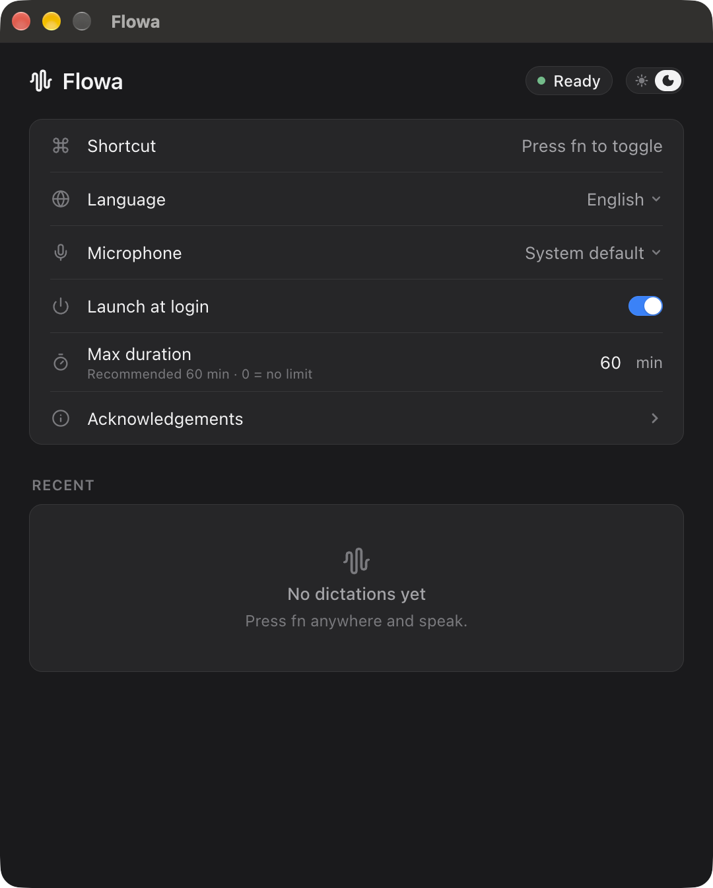

# Flowa

Flowa is a small push-to-talk dictation app for macOS, Windows and Linux. Press a key, speak,
press it again, and the text is pasted wherever your cursor is.

- **Free and open source.** MIT licensed, see [LICENSE](LICENSE). No account, no subscription,
  no usage limits.
- **Runs locally.** Speech recognition runs on your own computer with
  [whisper.cpp](https://github.com/ggml-org/whisper.cpp) and OpenAI's Whisper models. Your audio
  and your text never leave the machine. There is no cloud service and no telemetry.
- **Built with** Electron, React and TypeScript, with whisper.cpp v1.9.5 as the speech engine.

Flowa started as a Swift app for macOS and was made in Denmark. This repository is the
cross-platform Electron version.

<p align="center"></p>

---

## Contents

- [Supported platforms](#supported-platforms)
- [Download and install](#download-and-install)
- [Using Flowa](#using-flowa)
- [What goes over the network](#what-goes-over-the-network)
- [How updates work](#how-updates-work)
- [Build from source](#build-from-source)
- [Project layout](#project-layout)
- [Contributing](#contributing)
- [License](#license)
- [Trademark](#trademark)

---

## Supported platforms

| OS | Architectures | Installer | Speech engine |
|---|---|---|---|
| macOS 12 or newer | Apple Silicon (arm64), Intel (x64) | `.dmg` (signed and notarized) | whisper.cpp with Metal on Apple Silicon |
| Windows 10 / 11 | x64 | NSIS `.exe` (not Authenticode-signed) | whisper.cpp on the CPU |
| Linux | x86_64 | `.AppImage` and `.deb` | whisper.cpp on the CPU (needs `libgomp1`) |

Windows on Arm is not built. GPU acceleration on Windows and Linux (Vulkan, with automatic
CPU fallback) is in progress.

### System requirements

Flowa ships the Whisper large-v3 turbo model (about 1.6 GB) and transcribes on your machine,
so it needs a reasonably capable computer.

| | Minimum | Recommended |
|---|---|---|
| RAM | 16 GB | 32 GB |
| CPU | Modern 64-bit 4-core CPU (x64 needs AVX2, roughly 2013 or newer) | 8+ cores, or Apple Silicon |
| GPU | Not required | Apple Silicon (Metal) |
| Disk | 4 GB free | 8 GB free |

---

## Download and install

Installers are published on **[GitHub Releases](https://github.com/maxkongerskov/flowa-electron/releases/latest)**.

| Platform | File |
|---|---|
| macOS, Apple Silicon | `Flowa-<version>-arm64.dmg` |
| macOS, Intel | `Flowa-<version>-x64.dmg` |
| Windows x64 | `Flowa-Setup-<version>-x64.exe` |
| Linux AppImage | `Flowa-<version>.AppImage` |
| Debian / Ubuntu | `flowa_<version>_amd64.deb` |

The `*-mac.zip`, `*.blockmap` and `latest*.yml` files on a release are for the built-in updater.
You do not need to download them.

**macOS:** open the dmg and drag Flowa to Applications. On first launch Flowa asks for
Microphone, Input Monitoring (for the `fn` key) and Accessibility (to paste) permissions.

**Windows:** the installer is not Authenticode-signed, so SmartScreen may warn about an
unknown publisher. Choose *More info* and *Run anyway*. Updates are still verified with an
ed25519 signature (see [How updates work](#how-updates-work)).

**Linux:** `sudo apt install ./flowa_<version>_amd64.deb`, or make the AppImage executable
(`chmod +x Flowa-<version>.AppImage`) and run it. Pasting into other apps needs `xdotool`
(X11), or `wtype` / `ydotool` (Wayland); without one of them Flowa copies the text to the
clipboard only.

---

## Using Flowa

One press of the dictation shortcut starts recording, the next press stops it and pastes the
transcript into the app you were using.

| | Default shortcut | Other options |
|---|---|---|
| macOS | `fn` | Any key or chord, or a modifier tapped alone (Right Option, …) |
| Windows | `F8` | Any key or chord, or a modifier tapped alone (Right Alt, …) |
| Linux | `F8` | Any key or chord on X11. Wayland often blocks global shortcuts |

Change it from **Home → Shortcut**, the tray menu, or the app menu. On Home you can also pick
the language (99 languages or auto-detect), the microphone, the hardware (automatic GPU, or
CPU) and the speech model:

| Model | File | Size | Notes |
|---|---|---|---|
| Whisper large-v3 turbo (default) | `ggml-large-v3-turbo.bin` | ~1.6 GB | Bundled in the installers |
| Whisper small (multilingual) | `ggml-small.bin` | ~466 MB | Downloaded the first time you select it |

Settings and your recent dictations are stored locally in:

| OS | Folder |
|---|---|
| macOS | `~/Library/Application Support/Flowa-Electron/` |
| Windows | `%APPDATA%\Flowa-Electron\` |
| Linux | `~/.config/Flowa-Electron/` |

---

## What goes over the network

Flowa does not send audio or text anywhere. It only connects to the internet for:

1. **Update checks** against this repository's GitHub Releases (once at launch, and when you
   click *Check for updates*).
2. **Model downloads** from
   [huggingface.co/ggerganov/whisper.cpp](https://huggingface.co/ggerganov/whisper.cpp), only when
   a model is not already on disk (for example the first time you pick Whisper small). Each file is
   checked against its SHA-1 before use.

whisper.cpp runs as a local server bound to `127.0.0.1` on a random port.

---

## How updates work

Flowa uses [electron-updater](https://www.electron.build/auto-update) with GitHub Releases as the
feed (`latest.yml`, `latest-mac.yml`, `latest-linux.yml`).

1. Flowa checks the feed at launch. When a newer version exists, Home shows a banner.
2. Nothing downloads until you click **Download**. Progress stays in the banner.
3. Every update file is signed with **ed25519** over its SHA-256. The app refuses to install a
   file whose signature does not match the public key built into it
   (`src/shared/updatePublicKey.ts`). On macOS the app must also carry a valid Developer ID
   signature.
4. When the download is verified, Flowa quits and restarts into the new version.

| Install type | Updates itself? |
|---|---|
| macOS (dmg install of 1.2.2 or newer) | Yes |
| Windows NSIS | Yes |
| Linux AppImage | Yes |
| Linux `.deb` | Yes, when `dpkg`/`apt` is available; otherwise opens the release page |
| Builds you compile yourself | No. Unsigned builds open the release page instead |

The private signing key is kept offline by the maintainer and is never committed.

---

## Build from source

### Requirements

- Node.js 20 or newer (CI uses Node 22) and npm
- git and CMake
- A C/C++ toolchain: Xcode Command Line Tools (macOS), Visual Studio 2022 Build Tools (Windows),
  `build-essential` (Linux)
- macOS only: Swift (from Xcode Command Line Tools) for the small native helper

### Run it locally

```bash
git clone https://github.com/maxkongerskov/flowa-electron.git
cd flowa-electron
npm ci                      # installs dependencies and fetches the Electron binary (postinstall)
npm run setup:mac-helper    # macOS only: builds resources/mac/flowa-helper (fn key + paste)
npm run setup:whisper       # builds whisper.cpp v1.9.5 into resources/bin/<platform>-<arch>/
npm run setup:model         # downloads ggml-large-v3-turbo.bin (~1.6 GB, SHA-1 checked) into models/
npm run setup:small         # optional: ggml-small.bin (~466 MB) into models/
npm start                   # builds and runs the app
```

`npm run dev` runs the app with hot reload for the renderer. If you skip `setup:model`, the app
downloads the model into its data folder on first run.

Optional whisper.cpp GPU variants (Windows / Linux):

```bash
FLOWA_WHISPER_VARIANT=cuda   npm run setup:whisper   # whisper-server-cuda
FLOWA_WHISPER_VARIANT=vulkan npm run setup:whisper   # whisper-server-vulkan (needs the Vulkan SDK)
```

### Tests and type checks

```bash
npm test             # vitest unit tests (tests/**/*.test.ts)
npm run typecheck    # tsc --noEmit on the main/preload and renderer projects
```

Development self-tests that need no hotkey (disabled in packaged builds):

```bash
npx electron-vite build
E=node_modules/electron/dist/Electron.app/Contents/MacOS/Electron   # Windows/Linux: node_modules/electron/dist/electron(.exe)
FLOWA_SELFTEST=capture FLOWA_SELFTEST_QUIT=1 $E .
FLOWA_SELFTEST=transcribe:$PWD/tests/fixtures/quick_brown_fox.wav FLOWA_SELFTEST_LANG=en FLOWA_SELFTEST_QUIT=1 $E .
```

### Package installers

```bash
npm run dist:mac     # dmg (macOS host)
npm run dist:win     # NSIS installer
npm run dist:linux   # AppImage + deb
```

These use `electron-builder.yml` and bundle whatever is in `resources/bin/<platform>-<arch>`,
`resources/mac` and `resources/win`. They do **not** bundle the speech model; the app downloads it
on first run. Windows and Linux installers can be cross-built on a Mac, but the whisper.cpp binary
in `resources/bin/<platform>-<arch>` must be built for the target OS.

Your own builds are unsigned and do not self-update. Official releases are built by the maintainer
with `npm run release`; the full release procedure (signing, notarization, update rehearsal) is
in the release scripts under `scripts/`.

---

## Project layout

```
src/shared     pure logic: prefs, shortcuts, languages, models, update policy, audio math
src/main       Electron main process: transcriber, pipeline, hotkey, windows, tray, permissions, paste, updates
src/preload    context-isolated bridges (window.flowa, window.flowaBar)
src/renderer   React views (index.html = main window, bar.html = Flow Bar)
native/macos   flowa-helper.swift (fn key tap, Input Monitoring, frontmost app, ⌘V)
resources      icons, tray images, Windows modifier hook
scripts        whisper.cpp build, model fetch, packaging and release scripts
tests          vitest suites and WAV fixtures
```

Security: `contextIsolation` and `sandbox` are on, `nodeIntegration` is off, a strict CSP is set,
only Flowa's own pages may use the microphone, and navigation and `window.open` are blocked.

---

## Contributing

Contributions are welcome: bug reports, fixes, translations of the UI copy, and platform testing
(especially Windows and Linux desktops).

### Issues

- Search [existing issues](https://github.com/maxkongerskov/flowa-electron/issues) first.
- For bugs include: Flowa version, OS and version, CPU/GPU, the shortcut you use, what you
  expected, and what happened. Logs help; do **not** paste dictated text you would not want public.
- Security problems: please do not open a public issue. Contact the maintainer privately via the
  GitHub profile instead.

### Pull requests

1. Fork the repo and create a branch from `main`.
2. Keep each PR focused on one change, and explain *why* in the description.
3. Add or update tests in `tests/` for logic changes. Pure logic belongs in `src/shared` so it can
   be tested without Electron.
4. Before you open the PR, these must pass locally:
   ```bash
   npm ci
   npm run typecheck
   npm test
   ```
5. For UI or platform changes, say which OS you tested on and attach a screenshot if relevant.
6. Do not commit model weights (`models/*.bin`), whisper.cpp builds (`resources/bin/`, `vendor/`),
   build output, or any keys. `.gitignore` already covers these.

### Code style

There is no separate linter or formatter config in the repo. Follow the existing code:

- TypeScript in `strict` mode (`tsconfig.node.json`, `tsconfig.web.json`); the type check must be clean.
- ES modules, 2-space indentation, single quotes, no semicolons.
- React function components with hooks in `src/renderer`.
- Short comments that explain *why*, not *what*.
- Import shared code through the `@shared/*` alias.

By submitting a contribution you agree that it is licensed under the MIT License of this project.

---

## License

Flowa is released under the [MIT License](LICENSE). Copyright (c) 2026 Max Køngerskov.

Flowa includes or downloads third-party software and model weights, including whisper.cpp
(MIT), OpenAI Whisper model weights (MIT) and Electron (MIT). See
[THIRD_PARTY_NOTICES.md](THIRD_PARTY_NOTICES.md) for the full list and their licenses.

## Trademark

The name "Flowa" and the Flowa icon and logo are not covered by the MIT license and are not licensed for reuse. Forks and redistributed modified versions must use a different name and a different logo. The source code itself remains available under the MIT License.
